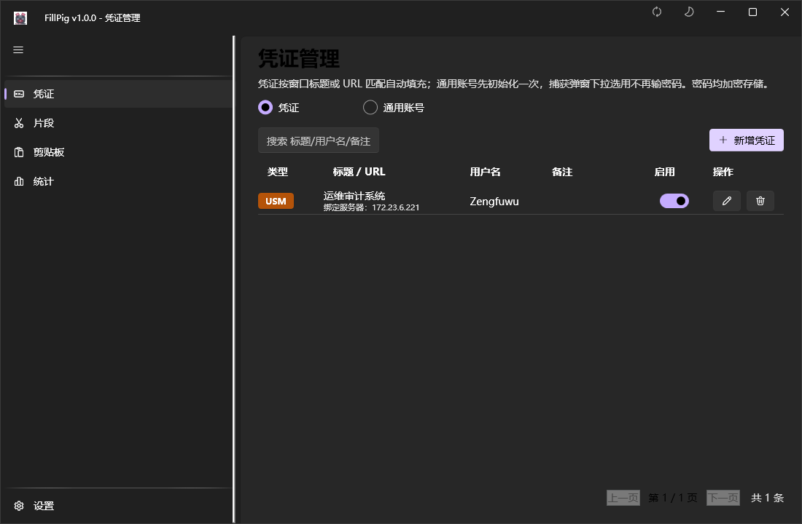
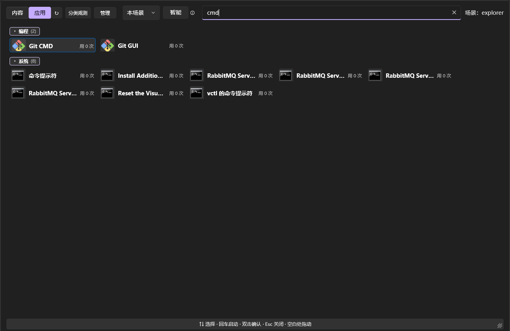
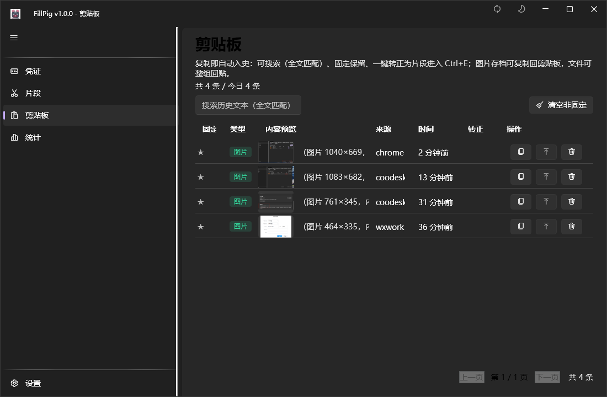
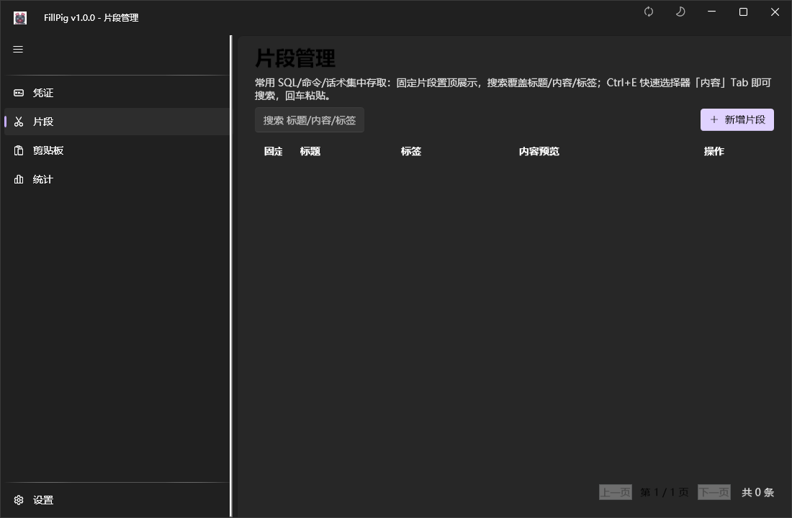
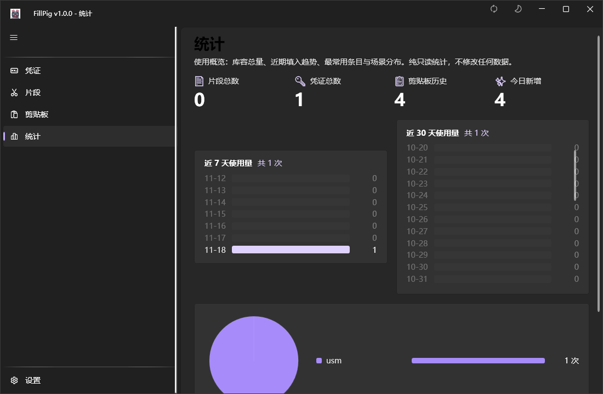
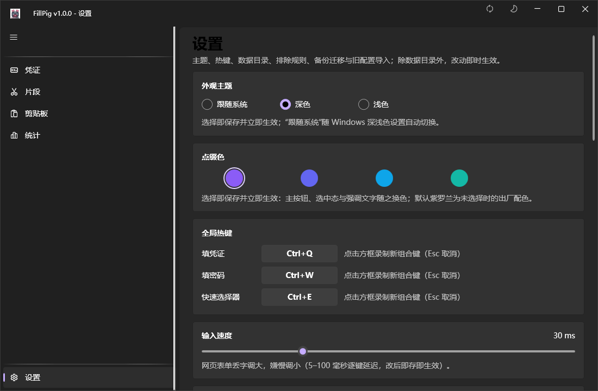
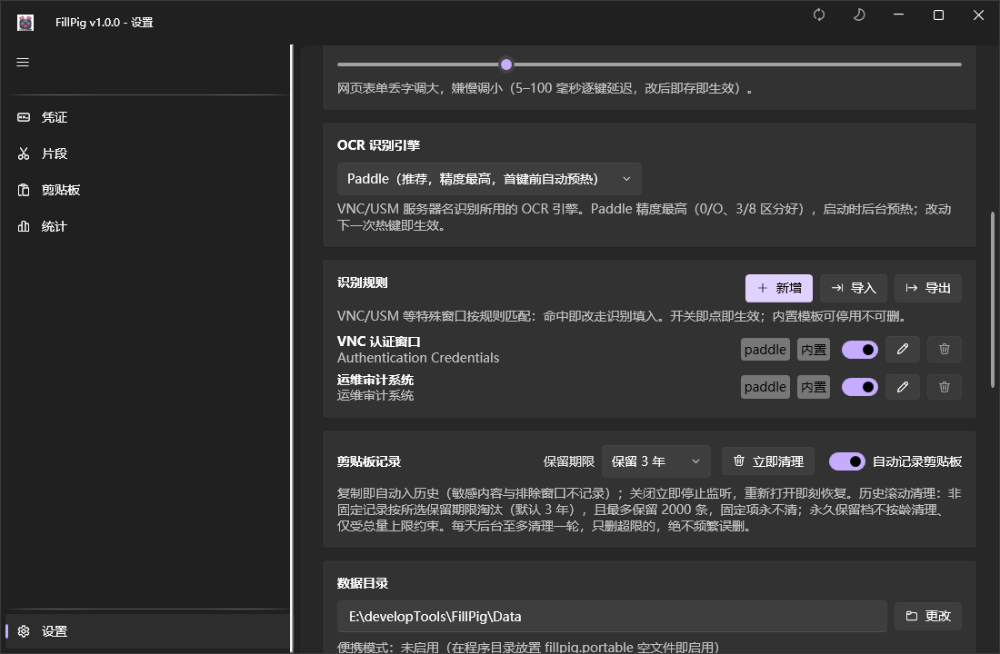

# FillPig — 场景感知的快速输入助手


Windows 桌面效率工具：**快捷键一键填入账号密码、常用片段；剪贴板自动记录；应用快速启动**。
纯本地、不联网、无遥测（唯一可选的网络行为是你自己开启的更新检查）。

> Windows 10/11 · .NET 10 · 安装即用 · 中文界面

---

## ✨ 核心功能

### 1️⃣ 一键填凭证（`Ctrl+Q` / `Ctrl+W`）

在任意登录窗口按 `Ctrl+Q`，自动输入 **账号 → Tab → 密码 → 回车**（输入前自动覆盖输入框残留）；`Ctrl+W` 只填密码。

- 按**窗口标题 / 页面网址**自动匹配凭证，命中即填
- **VNC / 运维审计（USM）** 等特殊窗口自动识别服务器名，多凭证窗口下拉区分
- 首次使用弹捕获窗，选一次账号之后全自动
- 密码 AES 加密存储（Windows 账户绑定 DPAPI，或主密码模式）



### 2️⃣ 应用快速启动（`Ctrl+E` → 应用）

类似系统搜索的应用启动器：**搜 `cmd` 直达"命令提示符"**，支持中文名显示、拼音与关键词匹配、**右键"以管理员身份运行"**；启动一次记一次数，越用越靠前。



### 3️⃣ 剪贴板自动记录

复制即入历史（文本 / 截图 / 文件），可全文搜索、固定保留、**一键转正为片段**；截图存档可复制回剪贴板。密码管理器等敏感窗口的内容自动不记录。



### 4️⃣ 片段库（`Ctrl+E` → 内容）

常用 SQL / 命令 / 话术存成片段，标题 + 内容 + 标签 + 固定；选择器里搜标题或标签，回车在光标处原样插入（多行 / Tab 保留）。



### 5️⃣ 使用统计

按窗口 / 应用 / 场景统计填充与启动次数，谁最常用一目了然。



### 6️⃣ 设置：一切可调

- **热键改键**：三个全局热键全部可换（带冲突检测）
- **OCR 识别引擎**：Paddle / Windows OCR 可选（VNC/USM 服务器名识别）；识别规则可自定义、导入导出
- **剪贴板保留策略**：保留期限（3 年 / 1 年 / 90 天 / 30 天）、自动清理、排除窗口
- **数据目录**：自定义存储位置（默认 `%AppData%\FillPig`），便携模式一键开启
- **备份与迁移**：导出 `.fpbak` 加密备份（主密码），新机导入
- **主题与点缀色**：深色 / 浅色 / 跟随系统 + 8 种点缀色即时切换（默认紫罗兰）
- **更新与代理**：检查更新（GitHub Releases，国内 Gitee 下载页）；网络代理设置弹窗支持 IP / 端口 / 账号密码认证，保存即生效





---

## 📥 下载安装

- **国内**：[Gitee 下载页](https://gitee.com/monmerzf/FillPig.Release/releases)（向导式安装包）
- **GitHub**：[Releases](https://github.com/MonsterZF/FillPig.Release/releases)

安装向导支持**自定义安装位置与数据存储目录**；卸载请用开始菜单 / 桌面的"卸载 FillPig"快捷方式（逐项列出删除的路径）。

## 🔒 隐私

- 所有数据（凭证、片段、剪贴板、统计）只存在你自己的磁盘上
- 不联网、不上传、无遥测；更新检查默认关闭，开启后也只访问 GitHub Releases
- 密码加密落盘，密钥绑定 Windows 账户（或主密码）

## 🛠 构建

```
dotnet build FillPig.slnx        # .NET 10 SDK
dotnet test FillPig.Tests        # 全量测试
```

打包安装程序：`tools/release/Publish-Release.ps1`（需要 Velopack vpk 工具）。

## 📄 许可

MIT
